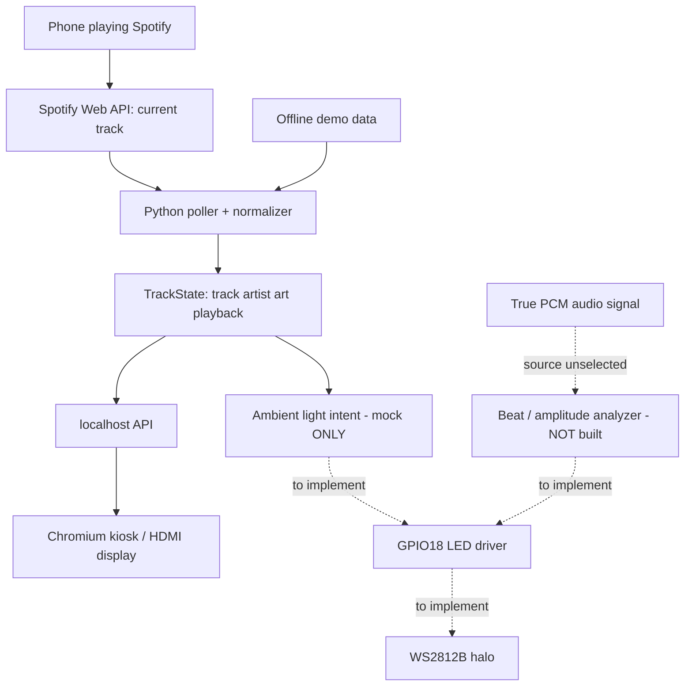

# Architecture draft (not a deployed production system)

 

The `.mmd` file in this folder is an editable Mermaid diagram; the diagram below mirrors it.

## Interface contract

`GET /api/state` returns `track` (title, artist, album, cover_url, is_playing, status, source), `lighting` (mode, color, brightness, driver=`mock`), `error` and `version`.

## Scope by phase

- **Implemented in starter:** standalone local service; demo provider; Spotify Web API adapter that consumes an existing access token; album art UI; mock ambient lighting policy; automated unit and HTTP smoke tests.
- **Devin Milestone A:** Spotify OAuth PKCE login / secure token refresh; end-to-end authorized account playback integration; HTML/CSS kiosk deployment on Pi 4; rate limit and network recovery tests.
- **Devin Milestone B:** safe WS2812B hardware driver; systemd unit; robustness and health logging; pilot tests on actual Pi hardware.
- **Separate feasibility gate (not promised):** true beat-reactive lighting needs an actual audio signal path; Spotify metadata API does **not** supply the audio samples. If an AirPlay-to-Pi route is selected, evaluate Shairport Sync metadata and PCM access; if playback remains on a separate speaker, consider a local mic or another authorized audio measurement source. Do not claim sample-accurate synchronization without measured latency.

## Hardware / audio architecture decision still open

V0 is a display+ambient-light accessory; it does not require taking over playback from the phone. It also intentionally does **not** assume speakers are wired to the frame. Separate wireless speakers are compatible with the metadata-only version, but beat analysis is not yet solved.

## API / license risk

Spotify's terms and availability limits must be verified before any commercial distribution. Existing code is for a personal technical prototype; it is not authorization to commercialize Spotify streaming or synchronize content contrary to developer policy.
